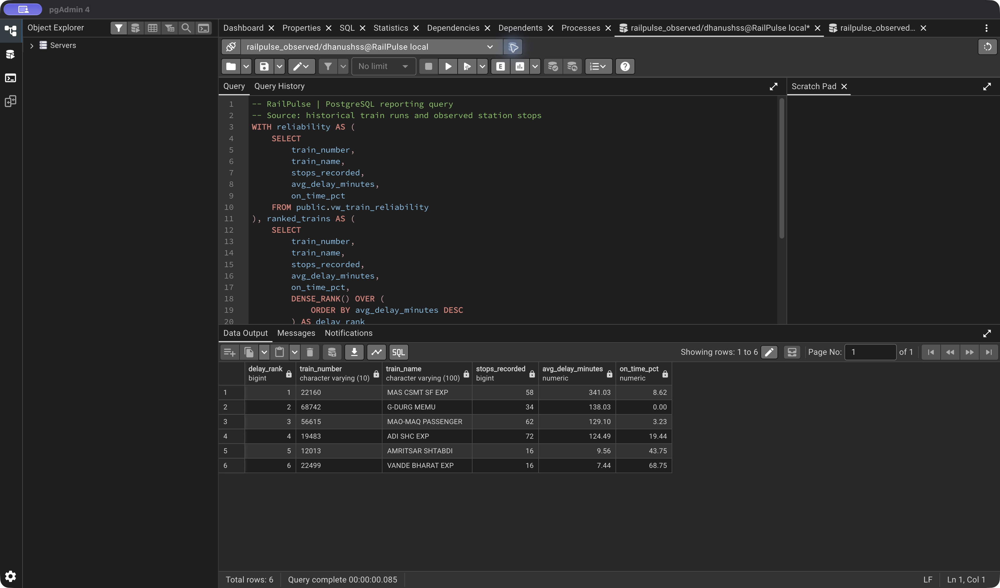
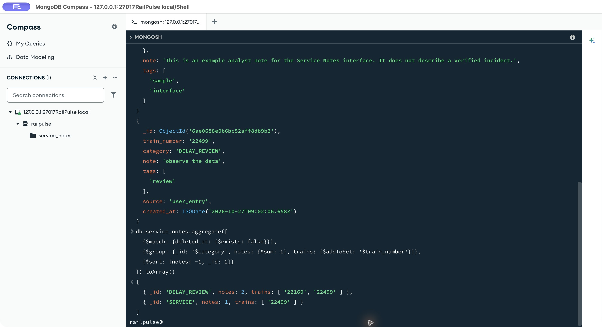

# RailPulse Level 3 implementation changes

## What changed

The original audited baseline was mainly the nine-table SQL design. The implemented project now connects that design to a Next.js website, persistent authentication, a sourced historical sample, MongoDB notes, SQL feedback CRUD, enforced roles, advanced reports, and visible database browsing.

| Area | Original baseline | Current Level 3 implementation |
|---|---|---|
| Railway records | Database design and small illustrative SQL data | One attributed historical file selected into 6 trains, 12 runs and 258 stop events |
| GUI | Planned | Railway-themed Next.js dashboard, train timelines, station insights and alerts |
| SQL integration | Standalone DDL | Authenticated API routes, parameterized SQL, live reads from local PostgreSQL |
| NoSQL | Not implemented | MongoDB service_notes with schema validation, compound indexes, filtering and aggregation |
| Authentication | User/role columns | scrypt hashes, eight-hour sessions, HttpOnly cookies and session revocation |
| Authorization | Three role names in schema | ADMIN manages all SQL feedback/reports; ANALYST manages own feedback; ownership guards in API and explorer |
| SQL CRUD | Audit examples | Railway feedback forms perform INSERT/SELECT/UPDATE/DELETE in explicit transactions |
| Advanced queries | SQL design | Admin reports executes HAVING/subquery, stored function and MongoDB aggregation and displays results |
| DDL proof | Core CREATE statements | Reversible course_demo.sql executes CREATE/ALTER/DROP, savepoint, rollback and DML |
| Database visibility | External SQL tooling | Database Explorer shows all 10 tables, 2 views, MongoDB collection, rows and constraints |
| User experience | Basic starter | Search, dates, sorting, details, CSV, note edit/trash/restore, feedback deletion confirmation |
| Final polish | Query text always visible | Queries collapsed under Show query; report titles and headings use readable labels |
| Evidence | Earlier audit | Build, 64 application checks, 29 course checks, database checks, browser screenshots and demo scripts |
| Documentation | Earlier source design | Current report, course checklist, Level 3 change log and balanced detailed two-person PDF |

## Why this goes beyond CRUD

Database triggers calculate delay and raise threshold alerts. Views and a stored function report reliability; grouped SQL with a scalar subquery selects trains above the sample average. MongoDB aggregation groups active notes. Keys, constraints, transactions and server-side permission checks protect consistency and ownership. The website connects these operations to train exploration and analyst workflows.

The course permits SQL + NoSQL OR SQL + Vector. PostgreSQL plus MongoDB fulfills the chosen option. The pgvector column/index remain optional future semantic-search infrastructure; automatic embeddings are not implemented.

## Two roles

- ADMIN: railway analysis, shared service notes, all SQL feedback, complete masked SQL browsing and advanced reports.
- ANALYST: railway analysis, shared service notes, own SQL feedback, and own sensitive account/session/feedback rows in the explorer.
- COMMUTER: reserved schema role; no dedicated interface. Only ADMIN and ANALYST are claimed as demonstrated roles.

The owner email is configured locally in the ignored environment file. Public registration cannot choose a role. Email ownership is not verified; the application remains local.

## Equal team responsibilities

Each person must own both database and application work, as required by the brief. These assignments explain the project and propose ongoing responsibilities; they do not rewrite actual commit authorship.

| Person 1 | Person 2 |
|---|---|
| Source selection/import, railway SQL, ER, constraints, triggers, views, stored function | Account/session SQL, feedback transactions/ownership, MongoDB schema/indexes/aggregation |
| Train/Station screens and Database Explorer explanation | Login, Feedback, Notes and Admin reports explanation |
| Demonstrate relationships, calculations, constraints, DDL and railway queries | Demonstrate roles, SQL CRUD, NoSQL operations, aggregation, tests and security |

Both review documentation and tests, contribute genuine commits and answer questions. The detailed PDF gives each person five dedicated explanation pages, plus shared introduction and checklists.

## Run the database demonstrations

- pgAdmin Query Tool: open demos/postgresql-demo.sql on railpulse_observed. It is read-only and shows records, views, stored functions, trigger definitions, indexes and constraints.
- MongoDB Compass: connect to mongodb://127.0.0.1:27017, open railpulse.service_notes; inspect documents, indexes, validation and aggregation.
- Optional JavaScript console: npm run mongo:console. It uses the official MongoDB Node.js driver; it is not mongosh. db is preconnected and demos/mongodb-demo.js contains matching commands.
- Reversible SQL demonstration: psql -d railpulse_observed -v ON_ERROR_STOP=1 -f sql/course_demo.sql.

## Student and instructor items remaining

Instructor team approval, unique title confirmation, names/IDs in the final submission, and genuine individual contributions/commits require the students. Do not claim live train tracking, production deployment, automatic semantic search, or national conclusions from this sample. The data source's missing station metadata/distances remain documented.

## Main submission files

- docs/project-report.md: problem, objectives, scope, architecture, design, implementation, security, tests, screenshots and future work.
- docs/course-requirements.md: course requirement evidence and execution checklist.
- docs/submission/RailPulse_Detailed_Level_3_Two_Person_Guide.pdf: detailed equal presentation split, code walkthrough, viva answers and demo sequence.
- sql/, demos/ and scripts/: executable schema, migrations, reversible demo, read-only query examples and test tools.

## Native database demonstration evidence

PostgreSQL was opened in pgAdmin on railpulse_observed and the CTE/window-function reliability query returned six train rows. MongoDB Compass was connected locally; the embedded mongosh executed document retrieval and category aggregation, returning two DELAY_REVIEW notes and one SERVICE note. These are analyst notes, including explicitly labeled illustrative seeds.

