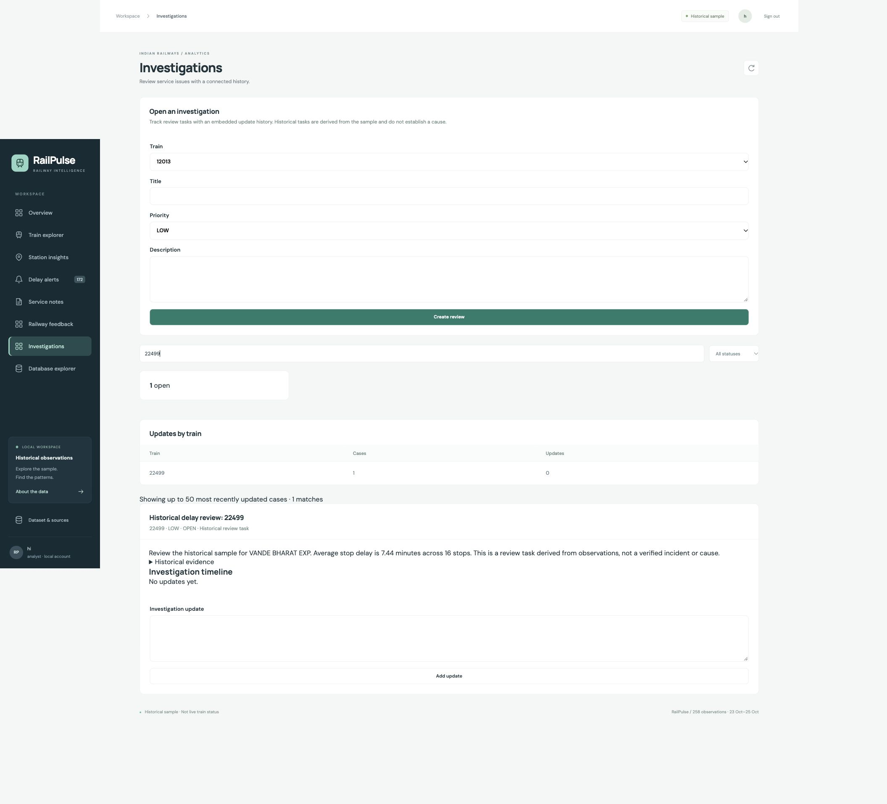

# MongoDB investigations expansion

MongoDB now has two meaningful collections: service_notes for flexible analyst observations and incident_reviews for case documents with embedded investigation histories. PostgreSQL remains the source of railway identities and timing data.

## Investigation model

Each incident_reviews document stores train_number, title, description, priority (LOW/MEDIUM/HIGH), status (OPEN/INVESTIGATING/RESOLVED), source, creator, timestamps, optional historical evidence and an updates array. Each embedded update records text, author, user_id, timestamp and optional status. Embedding makes one case's history readable in one document. An atomic $push appends an update together with a $set of its modification time/status. A maximum of 100 updates bounds document growth.

Authenticated analysts can create cases and append investigation notes. Only ADMIN can change case status. All cases are shared analyst workspace records. Updates are operational history, not an immutable audit log: a privileged database operator can still modify the collection.

## Data provenance

setup:incidents creates six historical review tasks from vw_train_reliability, with observed-stop count, mean delay and on-time percentage as nested evidence. These tasks do not assert a verified incident or cause. They are clearly labeled historical_review. The setup is idempotent for normal reruns and does not overwrite user changes to existing review tasks. User-created cases have source user_entry.

## MongoDB concepts demonstrated

- Nested evidence objects and embedded update arrays.
- Database JSON-schema validation for field types, required fields, enums and limits.
- Text index on title/description and $text/$search retrieval.
- Compound indexes on status/updated_at and train_number/created_at.
- Atomic $push/$set for timeline and status updates.
- $facet returns records, status summaries, train summaries and total matches from a filtered input.
- $group, $sum, $size, $count, $sort and $limit support reporting.
- Database Explorer lists and pages both collections, including nested arrays/documents.

## Run and demonstrate

```
npm run setup:incidents
npm run build
npm run start -- -p 3100
npm run check:incidents
```

Open Investigations, search a title/description, filter status, create a review and add updates. Sign in as ADMIN to move a case to INVESTIGATING or RESOLVED. Results show up to 50 recent matching cases with a full matching count. In Database Explorer select incident_reviews to show the raw embedded document. In Compass refresh databases and open railpulse.incident_reviews; inspect Documents, Indexes and Validation. See demos/mongodb-demo.js for read-only examples.

Nineteen dedicated checks pass for authentication, SQL train-reference validation, case creation, embedded updates, role denial, text search, facet summaries, explorer integration, MongoDB validation and indexes. The existing 64 application and 29 course checks also pass: 112 checks in total. Production build and browser search checks passed. Temporary QA records were cleaned up.

The earlier PDF guides describe the one-collection baseline and predate this addition. Read them with this supplement.


