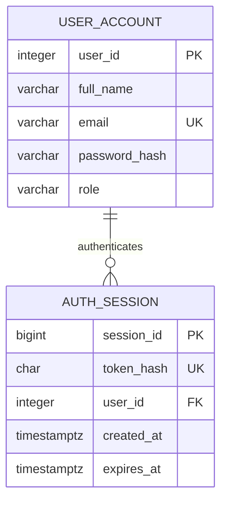
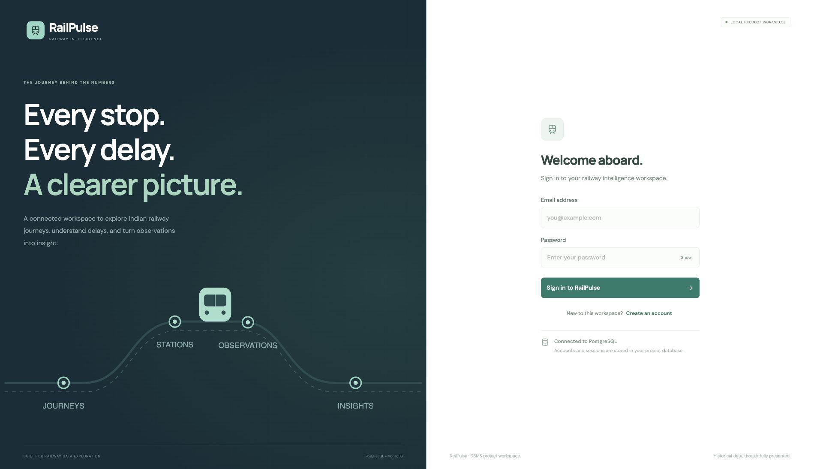
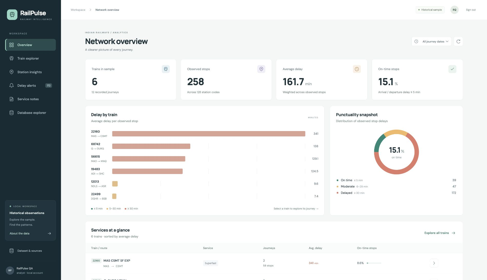
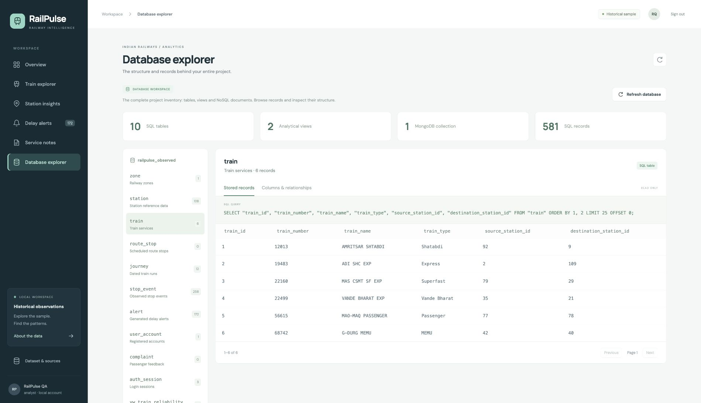

# RailPulse authentication and GUI implementation

## SQL model extension

The original 9-table railway model is preserved. Authentication adds:

AUTH_SESSION(**session_id**, token_hash UNIQUE NOT NULL, user_id FK → USER_ACCOUNT.user_id,
created_at NOT NULL, expires_at NOT NULL).

USER_ACCOUNT (1) → (N) AUTH_SESSION. Deleting an account cascades to its sessions.
`token_hash` contains a SHA-256 digest of a random 256-bit token. Passwords use salted scrypt.
The login form authenticates against USER_ACCOUNT; registration inserts an ANALYST row.
No hard-coded account or public demo password is included.

## Presentation sequence

1. Open `/login`, create an account, then sign in.
2. Explore the overview and switch the journey-date filter.
3. Open Train explorer, search a service, open its timeline and export CSV.
4. Open Database explorer: show all 10 tables, 2 views and service_notes.
5. Choose train, journey or stop_event to show stored SQL rows and their key relationships.
6. Choose user_account to show the registered account with the password value protected.
7. Create/edit a service note, then inspect the service_notes documents in the explorer.
8. Move a note to Trash and restore it using the Trash view.
9. Sign out and show that the workspace requires login again.

## Database viewer scope

Record counts are read from the connected database, not hard-coded display values. The viewer
allows only known project table names; it does not accept arbitrary SQL. Tables with no data are
explicitly shown as empty. Routes and complaints are not fabricated to fill empty tables.
Source timestamps have no timezone conversion. Analytical views are derived, so their row counts
are separate from the physical SQL record total. Retained soft-deleted notes are visible in the
raw document view with `deleted_at` metadata.

All authenticated local analysts share the workspace. This project does not claim enterprise
role isolation, email delivery, live railway tracking, or a complete production identity service.

## Verified screens

Screenshots from the local browser verification. Temporary QA accounts and notes were removed
after testing, so session and record counts may differ on the next launch.

Validation: production build passed; 64 integration checks passed; PostgreSQL object and
historical sample checks passed. Browser checks covered sign-in/sign-out, date and search
filters, journey details, CSV download, database schemas, and note create/edit/trash/restore.
