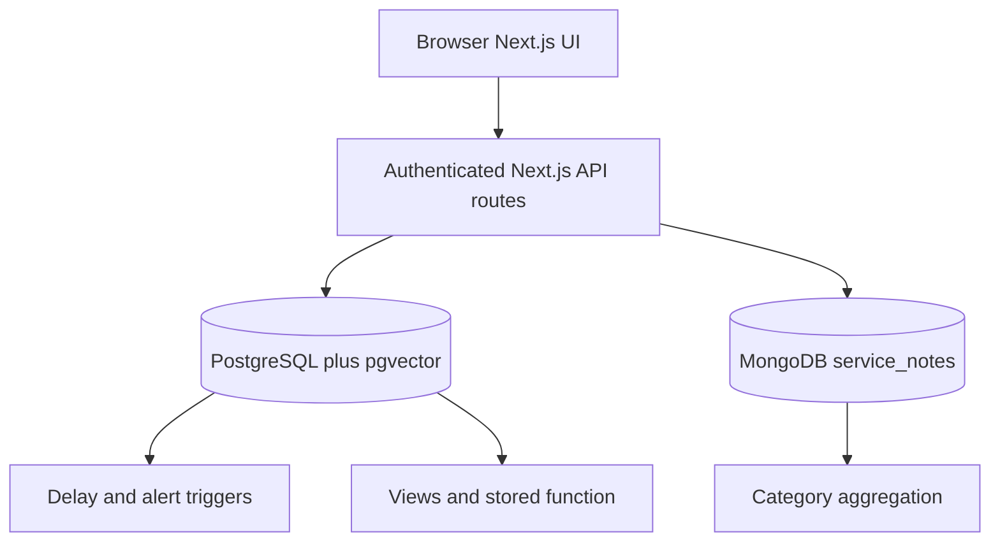
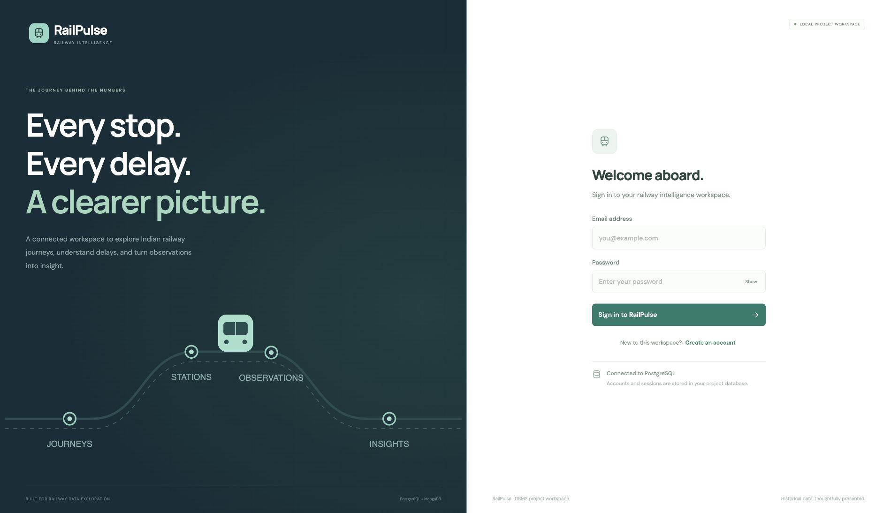
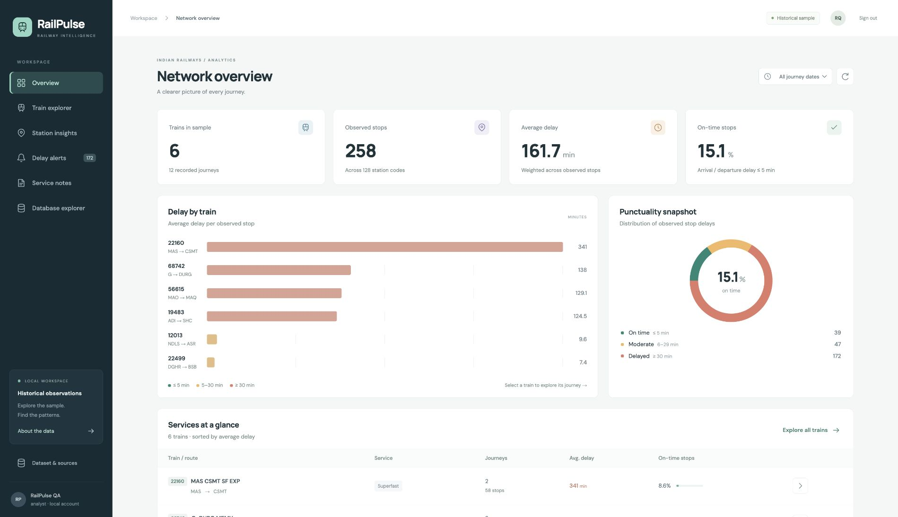
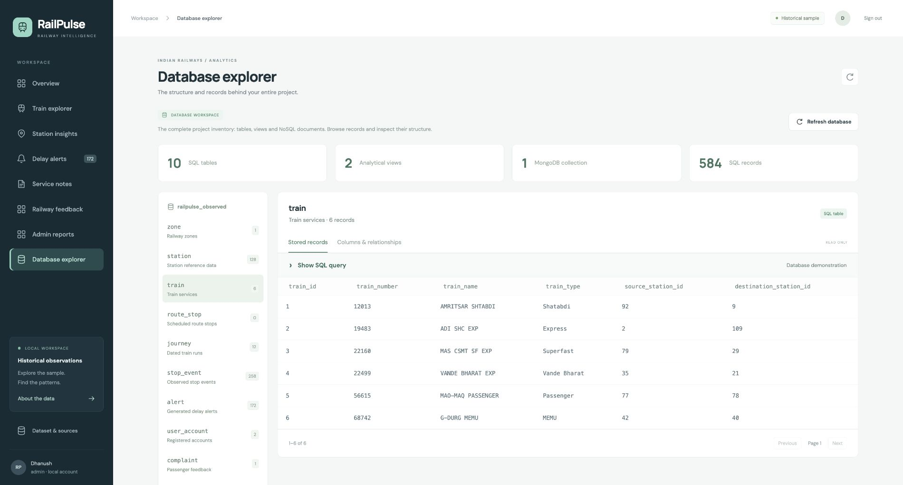
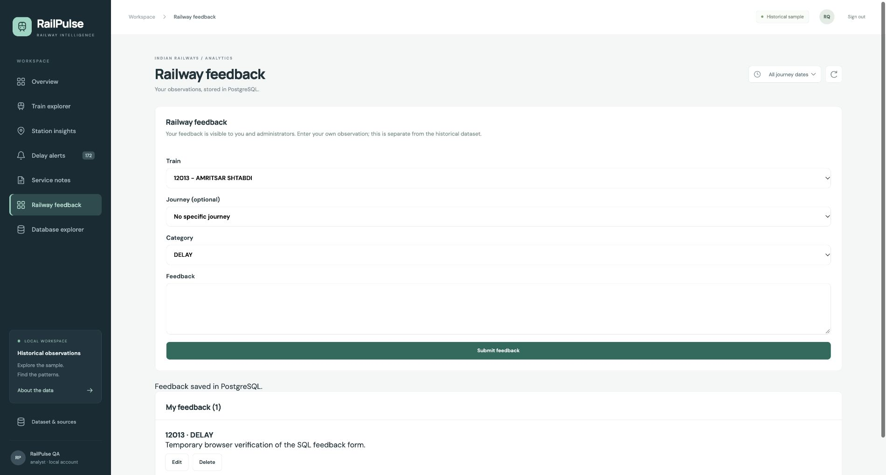
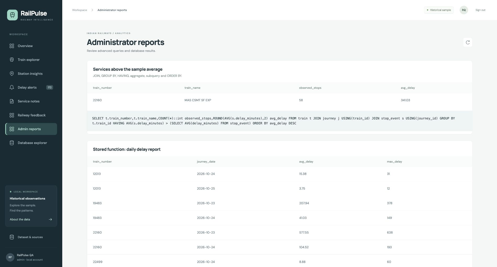

# RailPulse project report

## Problem statement and objectives

Scheduled and actual railway timing records are difficult to compare without a connected model. RailPulse stores train services, dated journeys and stop observations, calculates delays, highlights late stops, and gives analysts a workspace to review patterns and record context. Objectives are automatic consistent delay calculations, sample reliability summaries, traceable database records, user feedback, and flexible analyst notes.

## Scope and functional requirements

The local system supports database-backed registration/login/logout, train/date search, journey timelines, station analysis, alerts, CSV export, SQL feedback CRUD, MongoDB note CRUD with trash/restore, complete database browsing with protected credential fields, and administrator reports. ADMIN reviews all feedback and advanced reports; ANALYST manages their own feedback. Historical source rows are separate from user-entered feedback and illustrative notes. Live status, email delivery, embedding generation and production deployment are outside the implemented scope.

## Architecture

Credentials are environment settings. SQL statements use parameters for user data. A server-side table allowlist limits explorer queries. Feedback and sensitive account/session table browsing are scoped to the signed-in user unless ADMIN. The app runs at 127.0.0.1:3100.

## Database choice

PostgreSQL fits interconnected services, stops, runs and accounts because consistency, transactions, keys, joins and reporting are central. MongoDB fits analyst note documents with optional tags and variable details. SQL references are checked before note writes, but this is not a cross-database transaction or a native MongoDB foreign key. pgvector supports an optional future text search workflow; semantic search is not necessary to justify the implemented document collection.

## Design and data dictionary

The core ER diagram is in RailPulse_ER_Diagram.png/SVG/Mermaid. The relational schema describes the core nine tables; authentication-and-ui.md adds auth_session. Exact data types, nullability, defaults and constraints are available in SQL and the application's Columns & relationships display.

| Table | Key | Main fields and purpose |
|---|---|---|
| zone | zone_id | unique code, name, headquarters |
| station | station_id | unique code, name, city, state, zone FK |
| train | train_id | unique number, name/type, source/destination station FKs |
| route_stop | train_id + seq_no | scheduled times, station FK, distance and halt |
| journey | journey_id | train FK, date, status, unique train/date |
| stop_event | journey_id + seq_no | station FK, scheduled/actual timestamps, computed delay |
| user_account | user_id | name, unique email, salted password hash, role |
| complaint | complaint_id | account/train FKs, optional matching journey, text/category, optional sentiment/vector |
| alert | alert_id | journey FK, type, message, threshold, creation time |
| auth_session | session_id | unique token hash, user FK, creation/expiry timestamps |

route_stop and stop_event use dependent composite identities. Snapshots preserve the schedule applicable to a historical observation. Full timestamps handle overnight runs. The complaint composite FK prevents linking one train to another train's journey. Text length is also validated in PostgreSQL.

## NoSQL model and retrieval

railpulse.service_notes contains train_number, optional station_code, category, note, tags, source, created_at, optional updated_at/deleted_at and optional flexible details. A MongoDB JSON-schema validator enforces mandatory fields, types and limits. Compound indexes on train_number/created_at and category/created_at support recent-note retrieval. The note API filters active/trash documents and returns up to 50 recent matches. Admin reports uses match, group, sum, addToSet and sort to summarize active notes by category. Notes are shared analyst workspace records; SQL passenger feedback has account ownership.

## SQL implementation and important queries

The delay BEFORE trigger chooses arrival timestamps, otherwise departure, and clamps negative delays to zero. The AFTER trigger creates an alert on initial delay of at least 30 minutes or a threshold crossing from below. It does not create another alert for an unrelated update while already delayed. The two reliability views compute stop means and on-time shares. On-time means delay at most five minutes. Overall sample averages are weighted by observed stops, not by train.

sp_train_delay_report returns mean and maximum delay by journey date. Admin reports invokes it through a lateral join, and executes a train grouping with HAVING average above an overall-average subquery. The UI displays those queries. Complaint create/update/delete uses BEGIN/COMMIT with ROLLBACK on failure and atomic owner predicates. SQL DDL, savepoint and rollback demonstrations are provided in sql/course_demo.sql.

## Security and validation

Registration ignores client-supplied roles. A local configured owner email may register as ADMIN; other users are ANALYST. This is local provisioning, without email verification. Passwords use scrypt; session tokens are random and only their SHA-256 hashes persist in PostgreSQL. Sessions expire after eight hours and logout revokes the token. API guards enforce roles and ownership independently of hidden navigation. Password/token hashes are masked before the explorer returns records. SQL constraints and MongoDB validation supplement form checks.

## Data and limitations

The attributed source is pjay-in/indian-railways-delays, config 2026-10-10_, daily file 2026-10-25.parquet, CC BY 4.0. One downloaded file contains 153,006 stop rows. The chosen sample has six trains, 12 journeys and 258 stop events. The file lacks full station metadata, zone maps and route distances; unknown values remain labeled and route_stop stays empty. Some timestamps may be estimates. See data/SOURCE.md for selection and checksum. No national reliability inference or live tracking is claimed.

## Application screenshots and testing

The feedback screenshot contains an explicitly temporary browser fixture, removed after testing. Screenshots illustrate the verified workflows. Tests: production build; 64 application checks; 29 course checks; database object/sample checks; reversible SQL course demo. Checks cover authentication, role denial, private feedback access, full SQL CRUD, invalid journey/train association, server masking, stored-function reports, MongoDB aggregation, durable note edit/trash/restore, session revocation and direct SQL constraint rejection. Tests use temporary fixtures and clean them up. No load benchmark or public hosting security assessment is claimed.

## Conclusion and future enhancements

RailPulse demonstrates a working connection between database design, constraints, automatic computations, analytical queries and a Next.js application. Future work includes richer sourced station/timetable data, live feeds with provenance, complaint embeddings and semantic search, verified-email identity, finer analyst note permissions, and performance measurements at larger scale. Student team approval, title uniqueness and genuine per-member commits must be completed by the students; the repository does not fabricate those records.
